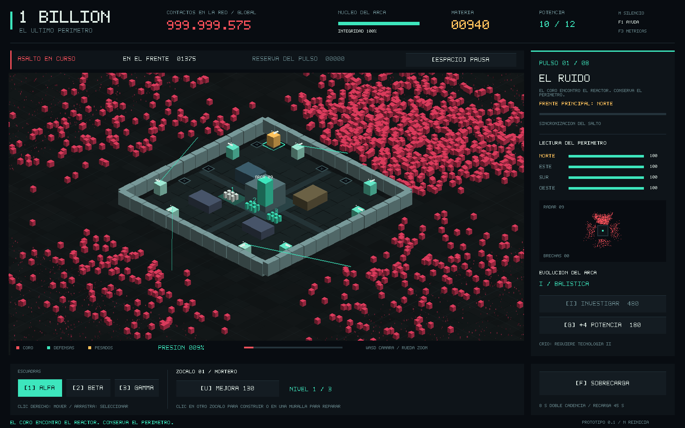

# 1 BILLION — El último perímetro

**Prototipo RTS isométrico en C++20 + SDL 3.4.18.** Sin motor de juegos, imágenes, modelos ni fuentes externas: todo se dibuja con bloques de colores.

No tenemos que matar a mil millones de enemigos. Tenemos que conservar las murallas hasta que el Arca pueda escapar.



## La idea

El Coro es una red de máquinas de terraformación que aprendió a reutilizar la vida como materia prima. El reactor del último refugio humano necesita ocho pulsos para abrir una ruta de escape; cada pulso también anuncia nuestra posición. Los primeros atacantes exploran. Después llegan corredores, arietes, artillería corrosiva, Heraldos, Arcontes y finalmente el Soberano.

La tecnología defensiva evoluciona a partir de los patrones recuperados de la horda. Reciclamos sus carcasas, ampliamos la potencia del reactor y desbloqueamos diseños que la nanoforja ya conoce. No inventamos una revolución científica en diez minutos: conseguimos fabricar lo que antes no podíamos alimentar.

La historia completa, sus justificaciones, la curva de dificultad y otras ambientaciones posibles están en [docs/DISENO.md](docs/DISENO.md).

## Qué se puede jugar

- Ocho oleadas, cuatro frentes y 48 tramos de muralla con daño, brechas y reconstrucción.
- 24 posiciones para repetidoras, morteros y crioemisores. Construcción y mejoras durante el combate.
- Tres escuadras móviles: selección por clic, arrastre o teclado; movimiento con clic derecho y fuego automático.
- Materia reciclada, presupuesto de potencia, tres etapas tecnológicas y sobrecarga temporal.
- Siete arquetipos enemigos. Los jefes llegan en los pulsos 3, 6 y 8; el pulso 6 tiene dos Arcontes.
- Preparación entre oleadas, pausa táctica con órdenes, victoria, derrota y reinicio.
- Radar, integridad de cada frente, cámara libre, zoom, audio procedural opcional y modo de carga.

## Jugar en Windows

**Con una compilación descargada:** en [Actions](https://github.com/DonMAriando/1billion/actions), abrí una ejecución terminada del workflow **Build and verify**, descargá el artefacto `one-billion-Windows-x64`, extraé el ZIP y ejecutá `one_billion.exe`. El workflow se incluye en este proyecto; los artefactos aparecen cuando la ejecución correspondiente termina correctamente.

**Desde el código:** necesitás Visual Studio 2022 o sus Build Tools, con *Desarrollo para el escritorio con C++*, Windows SDK y CMake 3.24 o superior. Ejecutá `COMPILAR_WINDOWS.bat`; después `JUGAR_WINDOWS.bat`. La primera compilación descarga SDL de su distribución oficial y verifica su SHA-256. No hay dependencias adicionales de assets.

También podés usar la terminal:

```powershell
cmake -S . -B build/windows -G "Visual Studio 17 2022" -A x64
cmake --build build/windows --config Release --parallel
ctest --test-dir build/windows -C Release --output-on-failure
.\build\windows\Release\one_billion.exe
```

El SDL descargado se enlaza estáticamente. La compilación de MSVC usa el runtime estático para que la distribución no dependa de instalar otro runtime de Visual C++.

## Linux

Compilador con C++20, CMake 3.24+, Make o Ninja y dependencias de desarrollo para video/audio. En Ubuntu:

```bash
sudo apt-get install build-essential cmake ninja-build pkg-config \
  libx11-dev libxext-dev libxrandr-dev libxcursor-dev libxi-dev \
  libxfixes-dev libxss-dev libxtst-dev libasound2-dev libgl1-mesa-dev
cmake -S . -B build/release -G Ninja -DCMAKE_BUILD_TYPE=Release
cmake --build build/release --parallel
ctest --test-dir build/release --output-on-failure
./build/release/one_billion
```

Si ya tenés SDL 3.4.18 instalado, CMake lo detecta mediante su paquete CONFIG. Para compilar sin descargar dependencias, usá `-DONEBILLION_FETCH_SDL=OFF` y, si hace falta, `-DSDL3_DIR=...`.

## Controles

| Control | Acción |
| --- | --- |
| Enter | Iniciar la siguiente oleada durante preparación |
| Espacio | Pausa táctica; permite construir y dar órdenes |
| Clic izquierdo | Seleccionar una torreta, un zócalo, una muralla o una escuadra |
| Arrastrar / Shift + clic | Seleccionar varias escuadras |
| 1 / 2 / 3 | Seleccionar Alfa / Beta / Gamma |
| Clic derecho | Mover las escuadras seleccionadas dentro del refugio |
| Q / E / T | Construir repetidora / mortero / crioemisor en el zócalo seleccionado |
| U / R | Mejorar la torreta / reparar el tramo seleccionado |
| I / G | Investigar / ampliar la potencia |
| F | Sobrecarga: doble cadencia durante 8 s; recarga de 45 s |
| WASD o flechas | Mover la cámara |
| Botón central + arrastre | Desplazar la cámara |
| Rueda | Zoom alrededor del cursor |
| M / H | Silenciar / reducir movimiento ambiental |
| F1 / F3 / F11 | Manual / métricas / pantalla completa |
| N / Esc | Reiniciar / salir; Esc cierra primero el manual |

**Primer intento:** construí un mortero en el zócalo 01, reforzá las torretas del norte y mové una escuadra hacia ese frente. El primer ataque principal llega por ahí con la semilla predeterminada. Usá la pausa para reorganizarte. Investigar se habilita en los pulsos 2 y 5; el crioemisor requiere tecnología II.

## Escala y rendimiento

`1 billion` significa **1.000.000.000 = 10⁹**. Esa cantidad existe como reserva estratégica de 64 bits. El frente simula unidades individuales; la masa del horizonte usa 12.000 marcadores visuales simplificados. El contador global baja con las bajas reales. No se crean mil millones de objetos.

El cupo predeterminado es de 32.768 enemigos concurrentes, configurable hasta 131.072. Cuando el cupo se llena, las incorporaciones pendientes esperan: no desaparecen enemigos ni se reserva memoria adicional. La cifra por oleada es distinta del cupo de concurrencia.

La simulación corre a 30 Hz y el render interpola posiciones. Datos de enemigos en arrays contiguos, borrado por intercambio, grilla espacial, buffers de geometría reutilizados, profundidad por buckets, descarte fuera de cámara y efectos con cupo fijo. Recursos SDL y memoria de C++ tienen propietarios RAII y destrucción ordenada.

Las pruebas comprueban **cero asignaciones de C++ durante los ticks, el reinicio y el inicio de oleada**. Esa comprobación no significa que SDL o el driver gráfico jamás asignen memoria internamente. El panel F3 informa los buffers propios de CPU, no toda la RAM/VRAM del proceso.

Para mediciones, metodología y límites: [docs/RENDIMIENTO.md](docs/RENDIMIENTO.md).

```bash
# Simulación sin inicializar SDL ni abrir ventana:
./build/release/siege_benchmark --enemies 65536 --seconds 60

# Escena interactiva de carga. Tiene recursos abundantes y muros invulnerables:
./build/release/one_billion --stress 65536

# Escena reproducible y captura para revisar el render:
SDL_VIDEODRIVER=dummy ./build/release/one_billion \
  --software --demo --capture prototype.bmp --capture-ticks 750

# Prueba de controles y render sin pantalla:
SDL_VIDEODRIVER=dummy ./build/release/one_billion --self-test-ui
```

`--demo` es un alias de una escena de carga con 16.384 enemigos. No representa una partida normal. Usá `--help` para las demás opciones.

## Verificación y organización

```bash
# Núcleo, benchmark y pruebas sin depender de SDL:
cmake -S . -B build/core -DONEBILLION_BUILD_GAME=OFF -DCMAKE_BUILD_TYPE=Release
cmake --build build/core --parallel
ctest --test-dir build/core --output-on-failure

# AddressSanitizer, UndefinedBehaviorSanitizer y detección de fugas en GCC/Clang:
cmake -S . -B build/asan -DONEBILLION_BUILD_GAME=OFF \
  -DONEBILLION_SANITIZERS=ON -DCMAKE_BUILD_TYPE=Debug
cmake --build build/asan --parallel
ASAN_OPTIONS=detect_leaks=1 ctest --test-dir build/asan --output-on-failure
```

| Archivo | Responsabilidad |
| --- | --- |
| `src/simulation.*` | Juego, oleadas, economía, targeting, grilla y pools. Sin SDL. |
| `src/presentation.*` | Proyección isométrica, geometría, HUD, entrada y audio. |
| `src/main.cpp` | Ciclo fijo, vida de SDL, argumentos y prueba de controles. |
| `src/benchmark.cpp` | Benchmark reproducible exclusivamente de simulación. |
| `tests/simulation_tests.cpp` | Economía, determinismo, saturación, memoria y campaña completa. |
| `.github/workflows/build.yml` | Compilaciones Windows/Linux, pruebas, sanitizadores y artefactos. |

Las pruebas incluyen una campaña completa con un comandante programado, la aparición y derrota de los cuatro jefes, una derrota por abandono, integridad de pools, conservación de la población global y saturación sin perder incorporaciones pendientes.

Es una base jugable para validar el asedio. Quedan para otras iteraciones el equilibrio con personas, mapas múltiples, guardado, multijugador, colisión física entre individuos y navegación alrededor de edificios. Las seis figuras de cada escuadra representan una sola entidad táctica de fuego; todavía no son seis soldados independientes.

SDL y los componentes incluidos en su distribución conservan sus licencias: [THIRD_PARTY.md](THIRD_PARTY.md).
